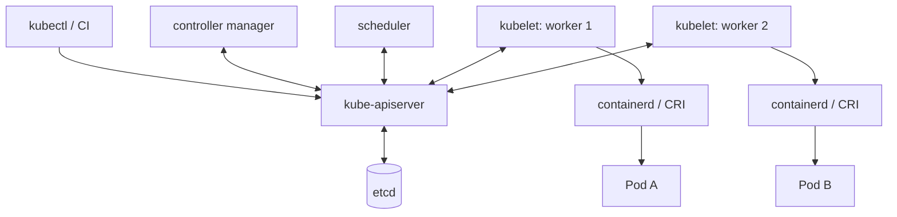

# 01｜Kubernetes 架构、声明式 API 与控制循环

## 1. 为什么需要编排

假设你的 API 有两份副本。如果手动启动容器，需要负责部署位置、监听地址、进程退出后重启、滚动升级、故障切换和发现服务。Kubernetes 将这些问题拆为 API 对象和持续运行的控制器。它不是自动写业务代码、自动修复所有 bug 或自动保证无故障的系统。



- API Server：认证、鉴权、准入、校验 API 请求，持久化对象状态；所有控制器通过 API 协作，而不是直接写 etcd。
- etcd：一致性的键值存储，保存集群 API 数据（不是业务数据库，也不是容器日志仓库）。生产应有备份与恢复方案。
- Controller Manager：多种控制器的集合。Deployment 控制器维护 ReplicaSet，ReplicaSet 控制器维护 Pod 数量。控制循环不断比较期望状态与观察状态。
- Scheduler：为尚未分配节点的 Pod 选择满足资源、约束等条件的节点，写入绑定结果。它不亲自启动容器。
- kubelet：每个节点上的代理，根据分配到本节点的 PodSpec，协调运行时和挂载/网络等组件，执行探针，报告状态。
- containerd：通过 CRI 接收容器管理请求。CNI 实现 Pod 网络；CSI 是存储驱动接口。Service 数据面可能由 kube-proxy 或其他网络实现负责；CoreDNS 提供服务名称解析。

## 2. 一次 apply 到应用可用

先观察现有系统：

```bash
source scripts/common.sh
k -n kube-system get pods -o wide
k get --raw='/readyz?verbose'
k api-resources | head -30
k explain deployment.spec.template.spec.containers
```

执行 `kubectl apply` 后 API Server 接受并校验期望状态。Deployment 控制器发现新对象，创建 ReplicaSet；ReplicaSet 创建 Pod 对象；Scheduler 绑定节点；节点 kubelet 调用运行时拉镜像、配置容器，报告状态；readiness 通过后，EndpointSlice 控制器等更新服务端点，数据面才能把请求送到就绪后端。每一步是异步收敛，并非 apply 一返回就代表服务可用。

## 3. 对象及 YAML

```yaml
apiVersion: apps/v1
kind: Deployment
metadata:
  name: lab-api
  namespace: devops-lab
spec:
  replicas: 2
```

这段故意不完整，不直接 apply。apiVersion 指定 API group/version，kind 指定资源种类，metadata 包含对象身份与标签，spec 规定希望系统达到的状态。status 由系统更新。Label 用于选择资源，annotation 用于附加信息；两者都不是机密存储。UID 是对象唯一身份，name 可在删除后复用；resourceVersion 用于并发控制和 watch，不要把它当用户可比较的全局时间。

Namespaced 对象：Pod、Deployment、Service、Secret 等；cluster-scoped：Node、PV、StorageClass、ClusterRole 等。`k api-resources --namespaced=true` 查看。`get all` 不是所有资源的意思，通常不包含 Secret、PVC、NetworkPolicy 等。

## 4. 声明式与命令式实验

```bash
bash scripts/deploy.sh
k -n devops-lab get deploy,rs,pods -o wide
k -n devops-lab get deploy lab-api -o yaml
k -n devops-lab get pods -l app=lab-api --show-labels
k -n devops-lab scale deploy/lab-api --replicas=3
k -n devops-lab get pods -w
# Ctrl-C 后
k diff -k k8s/base  # 有差异时退出码 1 属正常
k apply -k k8s/base
k -n devops-lab rollout status deploy/lab-api
```

`scale` 修改在线状态，Git 中仍声明 2。随后 apply 基础文件会尝试恢复声明的 replicas。`diff` 是预览，`apply --dry-run=server` 是服务端校验不持久化；客户端 dry-run 无法验证所有集群策略。线上优先从 Git 变更，避免手工与 GitOps 相互覆盖。

## 5. 自愈观察

```bash
POD=$(k -n devops-lab get pod -l app=lab-api -o jsonpath='{.items[0].metadata.name}')
k -n devops-lab get pod "$POD" -o jsonpath='{.metadata.ownerReferences}'; echo
k -n devops-lab delete pod "$POD"
k -n devops-lab get pods -w
```

删除的是 Pod，不是其 Deployment。控制器看到缺少副本，创建新 Pod；原 Pod IP/UID 不保证保留。如果删除 Deployment 则期望状态消失，不能期待自动重建（除非外部 GitOps 控制器重新 apply）。若节点资源不足，期望状态也可能无法达成。

## 6. 验收

- [ ] 画出 apply 到请求进入容器的流程并标注每一步责任组件。
- [ ] 实际观察 ownerReferences、replicas、readyReplicas、availableReplicas。
- [ ] 删除 Pod 后解释为什么自愈；解释为什么一个坏镜像不会因控制器反复重试自动变好。
- [ ] 用 `get`、`describe`、`explain`、`diff`、`apply --dry-run=server` 检查对象。
