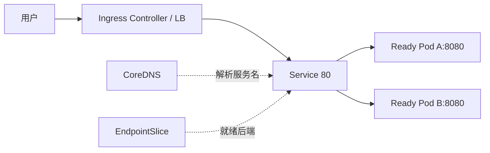

# 03｜网络：从 TCP/DNS 到 Service、Ingress

## 1. 先理解四层地址

Node IP 是节点地址，Pod IP 是 Pod 网络地址，ClusterIP 是 Service 的虚拟入口，外部 IP/域名来自入口设施。Pod 可以重建并改变 IP，所以业务调用使用 Service DNS 而非固定 Pod IP。默认集群网络通常允许 Pod 互通，NetworkPolicy 是否限制取决于 CNI。



这是逻辑请求路径；某些 Ingress controller 直接转发到 Endpoint，而非物理经过 ClusterIP。Service 资源提供 L4 地址和后端选择；Ingress 是 L7 HTTP 路由声明，需要相应 controller 才能生效；Gateway API 是更丰富的可扩展路由模型，需要实现和 CRD，并非所有集群默认安装。

Service 类型：ClusterIP 集群内部；NodePort 通过节点端口暴露；LoadBalancer 请求外部实现提供负载均衡器（本地 kind 默认不保证有外部 LB）；ExternalName 是 DNS CNAME 映射，不代理。Headless Service (`clusterIP: None`) 返回后端地址，常用于 StatefulSet。Service `port: 80` 是调用方端口，`targetPort: http` 对应 Pod 的 named port 8080，`nodePort` 是 NodePort 类型端口。

## 2. Service 与 DNS 实验

```bash
source scripts/common.sh
k -n devops-lab get svc lab-api -o wide
k -n devops-lab get endpointslice -l kubernetes.io/service-name=lab-api -o wide
k -n devops-lab run netcheck --image=busybox:1.36 --restart=Never --command -- sleep 3600
k -n devops-lab wait --for=condition=Ready pod/netcheck --timeout=120s
k -n devops-lab exec netcheck -- nslookup lab-api
k -n devops-lab exec netcheck -- nslookup lab-api.devops-lab.svc.cluster.local
k -n devops-lab exec netcheck -- cat /etc/resolv.conf
k -n devops-lab exec netcheck -- wget -qO- http://lab-api/
for i in 1 2 3 4 5; do k -n devops-lab exec netcheck -- wget -qO- http://lab-api/; echo; done
```

DNS FQDN 一般为 service.namespace.svc.cluster.local（cluster domain 可配置）。Service DNS 解析成功不代表有可用后端；它可能只返回 ClusterIP。重复调用通常看到不同 Pod，但并不保证每次交替（连接复用、会话黏性与实现影响）。EndpointSlice 的 `conditions.ready` 比只看数量更有用。

```bash
k -n devops-lab get endpointslice -l kubernetes.io/service-name=lab-api -o yaml
POD_IP=$(k -n devops-lab get pod -l app=lab-api -o jsonpath='{.items[0].status.podIP}')
k -n devops-lab exec netcheck -- wget -qO- "http://$POD_IP:8080/healthz"
```

直连 Pod 可以区分服务转发与应用自身异常。port-forward 示例：`k -n devops-lab port-forward svc/lab-api 8080:80`，另终端 curl localhost:8080；它建立 API 隧道到选定 Pod，不代表经过 Service 数据面或正常外部网络。

## 3. 可选 Ingress 实验

使用 Traefik Helm chart（先安装 Helm）。为保持本地实验简单，将 controller Service 设成 ClusterIP，通过 port-forward 进入 controller。不要等待不存在的云 LB。

```bash
helm repo add traefik https://traefik.github.io/charts
helm repo update
helm search repo traefik/traefik --versions | head
helm upgrade --install traefik traefik/traefik --kube-context kind-junior-devops \
  -n traefik --create-namespace --set service.type=ClusterIP --wait --timeout 5m
k get ingressclass
k -n traefik get svc
k apply -f k8s/optional/ingress.yaml
k -n devops-lab describe ingress lab-api
k -n traefik port-forward svc/traefik 8081:80
# 另终端执行
curl -i -H 'Host: lab.local' http://127.0.0.1:8081/
curl -i -H 'Host: wrong.local' http://127.0.0.1:8081/
```

预期正确 Host 200，错误 Host 404（具体取决于 controller 的其他路由）。Ingress status 没外部 IP 在本实验并不意味着不可用。若 chart 版本改变，检查实际 ingressClass 名、web Service port 和 provider 是否开启，按 `helm show values traefik/traefik` 修正。生产还需域名 A/CNAME 记录、TLS Secret/cert-manager、入口防火墙、超时与请求体大小配置。TLS SNI 和 HTTP Host 不完全相同：TLS 握手先发生。

卸载：`k delete -f k8s/optional/ingress.yaml`，`helm uninstall traefik --kube-context kind-junior-devops -n traefik`。

## 4. 网络故障实验：selector 与端口

```bash
k -n devops-lab patch svc lab-api -p '{"spec":{"selector":{"app":"nonexistent"}}}'
k -n devops-lab get endpointslice -l kubernetes.io/service-name=lab-api -o yaml
k -n devops-lab exec netcheck -- nslookup lab-api
k -n devops-lab exec netcheck -- wget -T 3 -O- http://lab-api/ || true
k apply -k k8s/base
k -n devops-lab exec netcheck -- wget -qO- http://lab-api/
k -n devops-lab patch svc lab-api --type=json -p='[{"op":"replace","path":"/spec/ports/0/targetPort","value":9999}]'
k -n devops-lab exec netcheck -- wget -T 3 -O- http://lab-api/ || true
k apply -k k8s/base
k -n devops-lab exec netcheck -- wget -qO- http://lab-api/
k -n devops-lab delete pod netcheck
```

第一种：DNS 仍可能正常，但后端空。第二种：后端 IP 存在，但目标端口不正确。若修复立即测试仍失败，等待 EndpointSlice/数据面收敛，再重复。区分 connection refused（对端拒绝或中间组件主动拒绝）、timeout（丢包/不可达/过载等）、HTTP 404（路径/Host）、502/503（代理或应用返回错误，需进一步确认）。错误码不能唯一定位根因。

## 5. 验收

- [ ] 不看答案定位 DNS 正常但 Service 不通的两种故障。
- [ ] 说清 `port`、`targetPort`、`containerPort`、`nodePort`。
- [ ] 从集群内与外部分别做测试，能说明 port-forward 的局限。
- [ ] 能解释 CNI、kube-proxy/替代数据面、CoreDNS、Ingress Controller 的不同职责。
