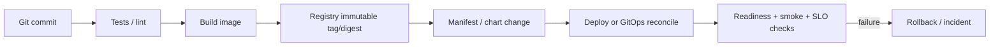

# 07｜交付工程：Kustomize、Helm、CI/CD、GitOps

## 1. 交付链路



CI 负责验证代码、构建制品；CD 把经过验证的制品交付到环境。镜像只构建一次，按 digest 在不同环境提升，配置独立，不为每个环境随意重构镜像。生产仓库一般通过 PR review、环境审批与最小权限进行变更。不要把有生产权限的 kubeconfig 放在普通 CI job 或 GitHub 仓库。

## 2. Kustomize 实战

Kustomize 不依赖模板字符串，而是从 base 叠加 patches、namespace、images 等变换。kubectl 内置 `-k`。本工程 dev/staging overlay 为**同一 namespace 的互斥演示**，只展示副本差异，绝不同时 apply 后声称环境隔离。真实环境可使用各自 namespace 或独立集群与不同凭证。

```bash
source scripts/common.sh
k kustomize k8s/base
k kustomize k8s/overlays/dev
k kustomize k8s/overlays/staging
k apply --dry-run=server -k k8s/overlays/dev
k diff -k k8s/overlays/dev || true
k apply -k k8s/overlays/dev
k -n devops-lab rollout status deploy/lab-api
k -n devops-lab get deploy lab-api
k apply -k k8s/overlays/staging
k -n devops-lab rollout status deploy/lab-api
k apply -k k8s/base
```

预期副本 1→3→2。如果 HPA 尚存在，它会调整 replicas，先删除 HPA。`k diff` 退出码 1 表示有差异，>1 常表示失败；CI 不应简单吞掉所有失败。理解 Git 文件是期望状态而不是集群导出对象的原样复制：不要提交 status、UID、managedFields 等自动生成字段。

## 3. Helm 实战

Helm chart 是 Kubernetes 应用打包方式；`Chart.yaml` 描述包，`values.yaml` 是参数，`templates/` 生成 manifests；release 是一次安装的实例，Helm 记录 revision。chart version 与 appVersion 是不同概念，后者通常是应用版本说明，不自动控制镜像。Helm 并不是持续调谐控制器。

本例 Helm 与主应用用不同 namespace/name，避免所有权冲突。先保证本地镜像已 load。

```bash
helm lint helm/lab-api
helm template helm-api helm/lab-api -n helm-lab
helm upgrade --install helm-api helm/lab-api --kube-context kind-junior-devops -n helm-lab --create-namespace --wait --timeout 3m
helm list --kube-context kind-junior-devops -n helm-lab
k -n helm-lab port-forward svc/helm-api 8082:80
# 另终端 curl http://127.0.0.1:8082/，然后停止 port-forward
helm upgrade helm-api helm/lab-api --kube-context kind-junior-devops -n helm-lab --set replicaCount=3 --set-string message='new helm config' --wait
helm history helm-api --kube-context kind-junior-devops -n helm-lab
k -n helm-lab get deploy,pods
helm rollback helm-api 1 --kube-context kind-junior-devops -n helm-lab --wait
helm uninstall helm-api --kube-context kind-junior-devops -n helm-lab
k delete namespace helm-lab
```

`helm template` 仅渲染，不能证明 CRD 存在或 RBAC 允许；`helm lint` 查常见问题。`--wait` 检查相关资源条件，仍需实际冒烟。Helm 可用 `--atomic`（确认所用版本支持）在失败时自动回滚/清理，但业务数据库迁移与外部副作用不自动撤销。查看 values 时不要把敏感数据放 Helm release 历史里。

## 4. GitHub Actions CI

`.github/workflows/ci.yaml` 在 Linux runner 创建专用 kind 集群、构建镜像、部署、运行集群内 HTTP 验证、始终清理。把工程提交到自己 GitHub 仓库即可在 Actions 观察执行（需仓库允许 Actions；runner 与外部下载可能受限制）。本示例未推送生产镜像、未获取生产凭证、没有实际 CD。

```bash
git init
git add .
git commit -m 'Add Kubernetes junior DevOps lab'
# 自行创建 GitHub 仓库并配置 remote，再 push
```

代码 review 练习：故意将 Deployment readiness path 改为 `/invalid`，提交到测试分支，预期 CI 在 rollout status 失败；修复后 CI 应重新通过。不要把失败结果伪造成成功。生产构建通常还需单元测试、SBOM、漏洞扫描、镜像签名、固定依赖及 action commit SHA、镜像推送、部署审批等。示例 actions 使用主版本标签便于阅读，正式流水线应锁定经过审核的 SHA。

## 5. GitOps 原理

GitOps 将 Git 期望状态作为发布来源，Argo CD/Flux 等持续比较 Git 与 live state，报告 drift，并按配置自动/手动同步。它与 CI 不同：CI 可以提交镜像版本变更到配置仓库，GitOps controller 在集群内拉取并协调。自动 prune 会删除 Git 中已移除的资源，需要评估风险；self-heal 可能覆盖手工紧急变更。紧急修复应同步更新 Git 并遵守审批流程。

入门练习（不安装 controller）：运行 `k diff -k k8s/base`，先手工 patch replicas，再观察 drift，然后 apply 恢复。可选扩展按 Argo CD 官方指南在独立本地集群安装，使用自己的只读 Git 仓库，先手动同步，不开启自动 prune；观察 Synced 与 Healthy 是不同概念。本课程没有伪造 Argo CD 实际运行结果。

## 6. 验收

- [ ] 解释 CI、CD、GitOps、Helm、Kustomize 的区别。
- [ ] 渲染两套 overlay，安装和回滚 Helm release。
- [ ] 跑通 GitHub Actions 并故意制造一次失败，写出失败阶段。
- [ ] 说明镜像 digest、配置管理、审批、回滚和数据库兼容性。
