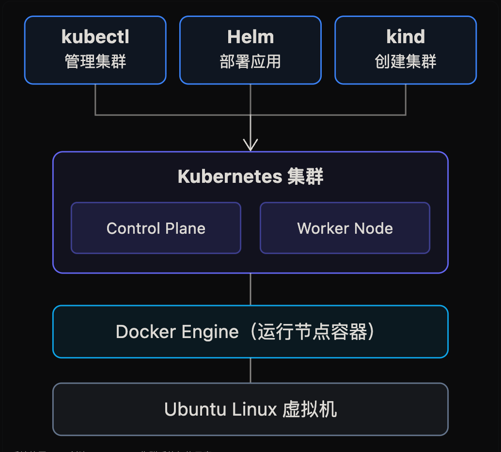

GCP实例进入：
proxyon

gcloud config set project agentic-devops-515809
gcloud config set compute/zone asia-northeast1-a
gcloud compute ssh k8s-lab --tunnel-through-iap

# 传送文件
gcloud compute scp /Users/tse/my_code/K8s/k8s-junior-devops/docs/env_setup/download_2.sh  k8s-lab:~/k8s/env_init/ \
  --tunnel-through-iap

